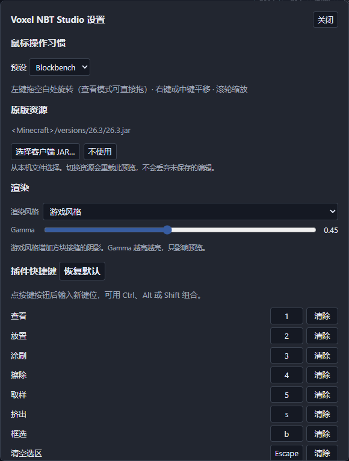
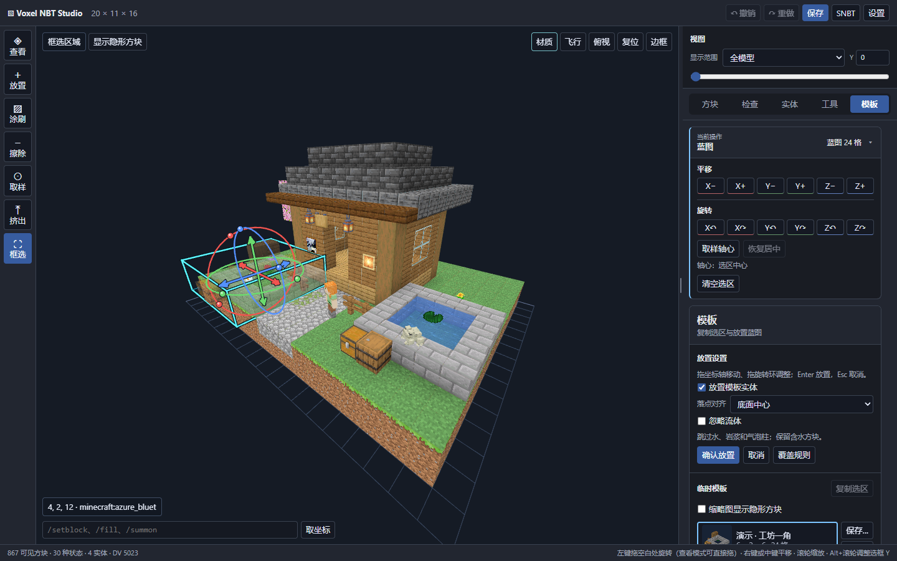
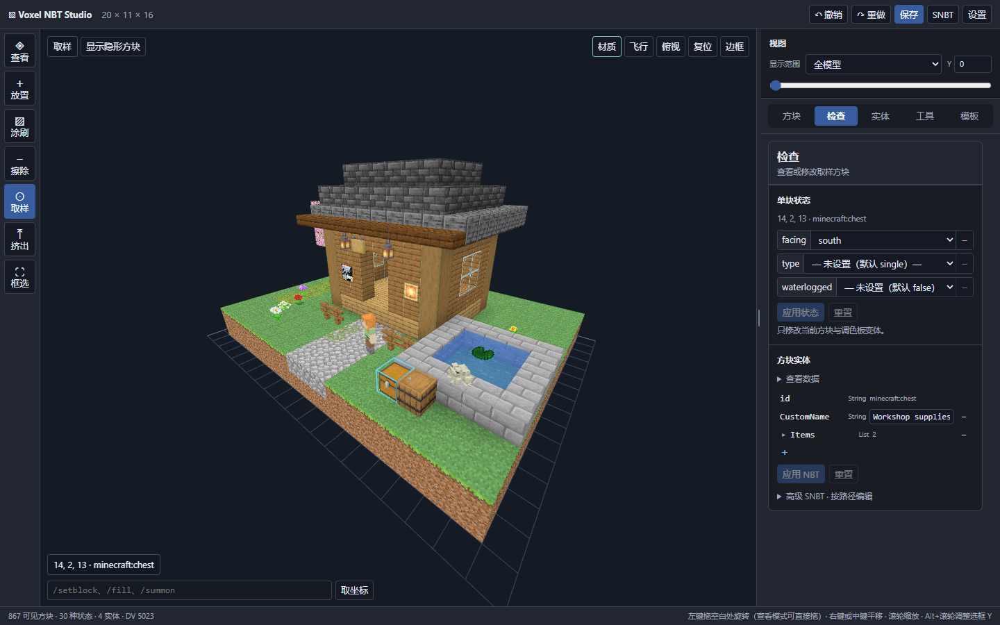
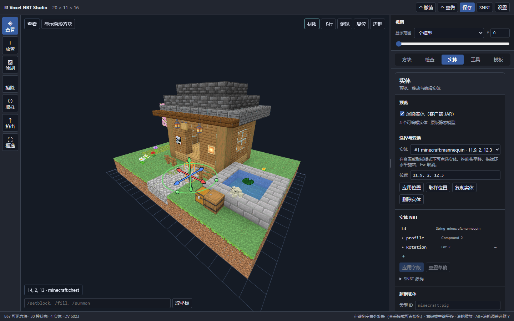
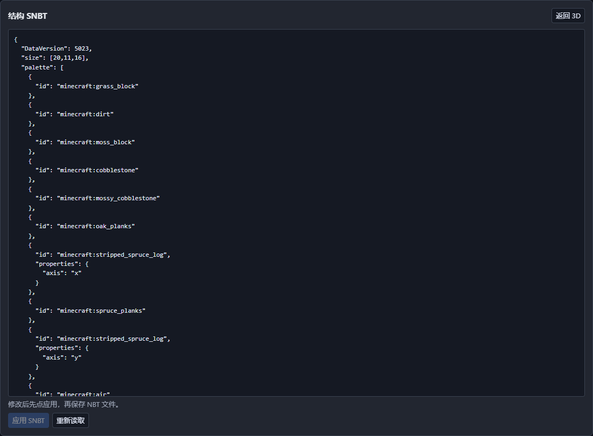
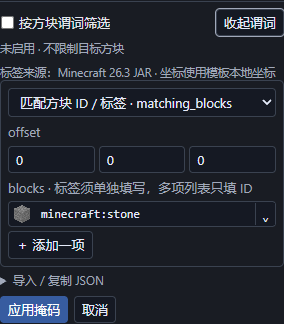

# Voxel NBT Studio

Voxel NBT Studio 是 VS Code 里的 Minecraft Java **结构 NBT** 查看器和方块编辑器。适合检查数据包 `data/<命名空间>/structure/` 下的结构模板、修改方块和方块实体。它不负责把 `.litematic` 转成 `.nbt`，也不是存档编辑器。

> **AI 项目声明**：本扩展主要由生成式 AI 编写、重构并编写文档，由项目维护者提出需求、测试和发布。AI 是开发方式，插件本身不提供 AI 功能，编辑本地结构不需要 AI 服务或 API 密钥。

**[下载 1.0.0 VSIX](https://github.com/KKNM231/voxel-nbt-studio/releases/download/v1.0.0/voxel-nbt-studio-1.0.0.vsix)** · [更新日志](CHANGELOG.md) · [开发指南](DEVELOPMENT.md) · [MIT License](LICENSE)


所有截图均在插件实际 Webview 中拍摄，使用本项目生成的临时演示结构，不含个人存档。原版材质从本地客户端 JAR 加载。

## 快速上手

1. 在 VS Code 中右键结构 `.nbt`，选 **用 Voxel NBT Studio 打开**。
2. 首次打开会提示导入原版材质。选本机的 Minecraft **客户端 JAR**，也可以点 **稍后再说**，继续用色块模式。
3. 按 `5` 取样：**方块**页签用来换画笔，**检查**页签用来改取样的那一格。要批量换方块，按 `B` 框选范围，再点 **填充选区**。
4. 点 **保存** 或按 `Ctrl+S` 写入文件。**应用状态 / 应用 NBT / 确认放置** 是提交到编辑器，还需要另按保存键才会写盘。

## 1. 安装、打开、新建和保存

- **安装或更新：** 使用 VS Code 桌面版（`1.90` 或以上），从 [GitHub Releases](https://github.com/KKNM231/voxel-nbt-studio/releases/tag/v1.0.0) 下载 `voxel-nbt-studio-1.0.0.vsix`。在扩展面板菜单选择 **从 VSIX 安装…**，或执行 `code --install-extension voxel-nbt-studio-1.0.0.vsix`，然后重载窗口。
- **打开现有结构：** 在 VS Code 资源管理器里右键 `.nbt` → **用 Voxel NBT Studio 打开**；也可以通过 **打开方式… → Voxel NBT Studio · 3D 结构编辑器**。插件不要求卸载其他 NBT 查看器，也不会主动更改 `.nbt` 默认关联。
- **新建结构：** 在命令面板运行 **Voxel NBT Studio: 新建 NBT 结构**，按 `X,Y,Z` 输入宽、高、深，例如 `32,16,32`，再选择保存位置。新建文件使用 Minecraft 26.3 的结构版本。
- **保存和撤销：** 用顶部按钮，或在 VS Code 中按 `Ctrl+S` 保存、`Ctrl+Z` 撤销。第一次改重要的结构建议先**另存为**。如果文件已被其他编辑器从磁盘改动，插件会阻止直接覆盖；请重新打开，或把当前编辑另存为副本。

支持 GZIP、Zlib 和未压缩的 Java 大端结构 NBT。普通编辑保留原文件的压缩方式、`DataVersion` 和未改动的 NBT 数据，不会自动升级结构版本。

## 2. 材质、视角和切层

侧栏顶部的 **视图** 负责显示范围与工作层；中间切换方块、检查、实体、工具和模板，下方内容独立滚动。框选、挤出或粘贴时会出现可折叠的 **当前操作**，位置范围、平移和旋转分区显示。折叠不会清除选区或输入。拖动画布与侧栏之间的分隔线可调整宽度；窄窗口上下排列时可调整高度。分隔线也可用键盘聚焦后按方向键，尺寸按窗口布局分别记住。实体及方块实体的 NBT 以紧凑列表显示，悬停可看完整字段名。

未配置材质时使用色块，不自动查找资源。关闭首次引导后，随时可点视窗上方的 **导入材质…**，或在 **设置 → 原版资源** 里选择：

| 选项 | 用途 |
| --- | --- |
| **选择客户端 JAR…** | 读取本机原版方块模型、贴图和各工具用的方块形状。要使用方块掩码，必须显式选择这个选项；不要选服务端 JAR 或模组 JAR。 |
| **不使用** | 不加载外部资源，以色块显示。 |

**方块命中：** 选择原版客户端 JAR 后，编辑工具优先使用方块的原版碰撞箱；没有碰撞箱的花草、作物、火把、铁轨或红石线改用原版选取轮廓。植物轮廓与编辑器中显示的位置对齐。射线仍能穿过地毯上方、玻璃板两侧和植物周围不属于轮廓的空隙。光源方块可点中央，流体仍由「允许选中流体」控制。开启「显示隐形方块」后，框选和擦除仍可操作相应标记。未选择 JAR 时保留整格命中；如果已选 JAR 但形状尚未加载或读取失败，不会静默退回整格检测。

画布左上角的 **显示隐形方块** 默认关闭。3D 画布获得焦点时，按 `Tab` 可切换；在侧栏和输入框中仍用 `Tab` 切换焦点。可在 **设置 → 插件快捷键** 中修改。开启后，红色小线框表示结构空位（没有方块记录；旧文件里已有的 `structure_void` 也显示红色），蓝紫色表示空气、洞穴空气和虚空空气。开关本身不改写 NBT 或清空已选格，标记随切层变化，大范围下可能抽样显示。开启显示后，可用 **擦除** 点击空气标记，将对应方块记录删成结构空位。**框选**也可点选标记、拉框或双击单格，选区计入空气与空位。填充会写入当前画笔；移动、旋转或复制会保留显式空气，空位只计入选区范围，不会擦掉目标方块。

画布右上角的 **边框** 按钮默认关闭。开启后以 **50% 不透明度**绘制结构尺寸边框。只有从模板原点 `(0,0,0)` 出发的三条边着色（X 红、Y 绿、Z 蓝），其余边为白色。边框包含空白边距，不会随切层或选区缩小。结构边框与青色选框都和方块对齐，被不透明方块挡住的线段不会穿透显示。

在 **设置 → 渲染** 可以选择 **平滑**（原有预览）或 **游戏风格**。后者需要选用客户端 JAR，使用方向光和方块接触处的阴影；Gamma 范围为 `0.00–1.00`（默认 `0.50`），越高预览越亮。它不模拟游戏世界里的昼夜和完整光照传播，不改写 NBT。

已有材质时，画布上方的 **材质 / 色块** 按钮可随时切换。箱子、铜箱和潜影盒用专用模型及原始 64×64 贴图；箱子的锁扣朝向由 `facing` 决定，双箱的左右半边由 `type` 指定。切换资源会重载预览，不会丢弃已提交但未保存的编辑。

- **鼠标预设：** 在 **设置 → 鼠标操作习惯** 选择。Blockbench 预设下，在查看模式拖左键旋转，右键或中键平移；Blender 预设下，中键旋转、`Shift`+中键平移、`Ctrl`+中键缩放。两种预设都可滚轮缩放。
- **切层：** 右侧可选 **全模型 / 到当前层 / 仅当前层**，用数字框或滑块设定 Y。修地板或地下房间时，可以先点 **俯视**，再设为 **仅当前层**。显示哪一层和实际写入的坐标不是一回事；批量编辑前要检查选区的两个角。
- **飞行：** 按 `F` 或点击 **飞行**。`W/A/S/D` 移动、`Space` 上升、`Shift` 下降，移动鼠标转向，滚轮调速（默认 **16 格/秒**，范围 **8–24**）。按 `Esc` 返回编辑，保留离开飞行时的位置和朝向。在本机 Windows 桌面版 VS Code 中，退出飞行时鼠标会回到 3D 画布中心；其他平台和远程工作区仍按原方式释放鼠标。飞行时仍显示选区、框选草稿和待放置蓝图；编辑手柄隐藏，不能修改或确认放置。



### 结构指令

点击画布左下的指令栏，或在画布上按 `/` 快速打开。`Tab` 接受建议，方向键可切换建议，`Enter` 执行（成功后清空指令栏，失败则保留原指令），`Esc` 取消取坐标或关闭建议。这里只编辑当前 NBT 结构，不向 Minecraft 运行中的存档、服务器或聊天窗口发送命令。

| 指令 | 示例 |
| --- | --- |
| `/setblock` | `/setblock 4 1 8 minecraft:chest[facing=west]{CustomName:"补给箱"}` |
| `/fill` | `/fill 2 1 2 6 4 6 minecraft:smooth_quartz replace #minecraft:logs outline` |
| `/summon` | `/summon minecraft:pig 4.5 2 8.5 {NoAI:1b}` |

- 坐标以**模板原点**为 `(0,0,0)`；写 `~` 或 `~1.5` 时，以当前摄像头位置为基准。方块命令最终落在整数格；实体支持小数坐标。飞行时按 `/` 会退出飞行并保留相同视点。
- 输入坐标时可补全已取样或框选的单格；`/fill` 支持直接填入当前选区的两角，也可用 **取坐标**（或「到画布取坐标…」）在画布连续点击两次。从第二角开始取坐标时只替换第二角；`Esc` 可结束取样，保留已填坐标。其他命令只需点一次。取坐标时绿色边框显示将填入的那一格：默认取命中的方块，按住 `Alt` 改取命中面外侧相邻一格。点空白工作层时不做偏移。取坐标期间暂停放置、涂刷、擦除、取样、挤出和框选；点击工具按钮或用快捷键切换工具会退出取坐标。
- `/fill` 默认 `replace`；`keep` 只写空气或无记录的格子，`outline` 只写外壳，`hollow` 还会将符合条件的内部格写成显式空气。`replace <筛选>` 支持方块 ID、状态、方块实体 SNBT，以及从选定 JAR 读取的 `#方块标签`；筛选后可加 `outline`、`hollow`、`destroy` 或 `strict`。
- `/setblock` 和 `/fill` 的目标支持 `方块[状态]{SNBT}`，方块状态及方块实体字段可用 `Tab` 补全。`destroy` 不保留被替换方块的数据，仍遵守方块实体覆盖保护；`strict` 直接写入。结构编辑器不会模拟世界掉落物或邻居更新，且不支持 `^` 局部坐标。
- `/summon` 需要原版客户端 JAR，可补全实体 ID、坐标和 mcdoc 中的实体 SNBT。省略 SNBT 与提供 `{…}` 会分别走对应的原版召唤逻辑。指令可撤销；执行后仍需 **保存** 才写入文件。


## 3. 放置、涂刷、擦除和框填

先在右侧 **方块** 页签里选画笔：点击调色板、用 **取样** 吸取，或搜索 **方块 ID**。搜索结果和当前画笔都显示方块预览。用逐行下拉框修改状态，或展开 **高级 · 手动输入状态** 写 `axis=y, waterlogged=false`。调整画笔不会立即修改结构。

| 默认键 | 工具 | 怎么用 |
| --- | --- | --- |
| `1` | **查看** | 只查看模型，不编辑。保留选区、框选草稿和待放置蓝图；切回原工具后可继续调整。 |
| `2` | **放置** | 在点中的方块面外添一格；点空白时可在当前工作层放置。不替换已有方块。 |
| `3` | **涂刷** | 替换已有方块的材质或状态，不填补空位。 |
| `4` | **擦除** | 删去模板里的方块记录，留下结构空位。结构空位不能作为画笔选用或用框填写入。擦除不等于写入 `minecraft:air`；如果希望结构放置时清掉对应位置的地形，应显式写入空气。 |
| `5` | **取样** | 吸取画笔方块，并在 **检查** 页签查看该格的状态与 NBT。 |
| `B` | **框选** | 点第一个角后，移动鼠标可预览到第二个角的长方体；再点一下固定第二个角。也可输入 A、B 两个 `X,Y,Z` 坐标。预览不会写入，需点 **填充选区**。可配合掩码只替换其中某种方块。 |

在 **方块 → 画笔方块 → 预设** 可快速选择空气、石头或草方块。设置好方块和状态后，点 **保存为预设…** 并命名；自定义预设保存在本地，可跨结构使用。展开预设列表，点击本地预设右侧的 **−** 可直接删除；内置预设不能删除。选取预设只切换画笔，不改动结构或调色板。「空气」是显式空气方块，不是结构空位。

放置、涂刷和擦除支持拖笔：按下就预览，松开才提交，整笔可一次撤销；松手前按 `Esc` 可取消。开启「显示隐形方块」时，擦过的格子会在拖笔过程中立即显示红色空位标记；取消时恢复原样。**工具 → 选取与镜像** 中的 X/Z 镜像只镜像画笔位置，不自动翻转 `facing` 等方块状态。水、岩浆、气泡柱默认会被取样和选区跳过；要选它们，勾 **允许选中流体**。

## 4. 框选、移动、旋转和挤出

1. 按 `B` 进入 **框选**，拖出选框、点击两个对角，或填写 A/B 后点 **选定范围**；双击可选单格。选定后可以点击 **填充选区** 使用当前画笔，也可以拖坐标轴移动、拖圆环旋转，不需要切换工具。
2. 想扩展 Y 范围时，先点框选的第一角，或先完成选区。鼠标放在画布上，`Alt`+滚轮调**上边界**，加 `Shift` 调**下边界**；向上滚扩大，向下滚缩小。这不会改变工作层。框填按预览中的 Y 范围实际填充。
3. 拖红 X、绿 Y、蓝 Z 箭头，或点右侧 `X− / X+` 等按钮逐格操作。**移动**不留副本；按 `S` 切成**挤出**会沿一根轴逐格复制，保留原方块。放置或挤出超出边界时，模板会扩展到能容纳新方块的最小范围；向负坐标方向扩展时，原有内容会整体平移，保持相对位置。编辑和扩容可一次撤销。普通移动仍不能越界。`Esc` 清空选区。

拖动平移箭头时，方块会按整格实时预览移动；松手提交，按 `Esc` 取消拖动并恢复原位。


### 旋转选区

- 在 **框选** 中选中方块后，拖动红 X、绿 Y、蓝 Z 圆环上的小球。拖动时预览位置，松手按 **90°** 的倍数提交；拖动中按 `Esc` 取消。也可点侧栏的 `X↶ / X↷` 等按钮精确旋转 90°。直箭头仍用于平移。
- 默认围绕选区外框的几何中心。若该轴无法直接对齐方块网格，轴心会吸附半格以确保旋转后仍落在整格。点击 **取样轴心** 后，再点任意方块或当前工作层的空位，就可将轴心固定在该格中心；点 **恢复居中** 返回默认。
- 旋转沿用移动的越界、覆盖和方块实体保护。绕 Y 轴按 Minecraft 26.3 规则更新方块朝向；绕 X/Z 倾转时会更新能够表达新方向的状态，但楼梯、门等不支持完整侧躺的状态会保留相关属性并提示。「框选 → 包含实体」默认关闭。开启后，框选范围内的普通实体会随选区平移或绕 Y 轴旋转；不随选区挤出。移动经过其他实体不会自动将其加入选区。关闭实体预览会清除选区中的实体（不清除已选方块），并禁用「包含实体」。重新开启预览后，需要重新框选才会纳入实体。含实体的选区和蓝图都只能绕 Y 轴旋转。

### 三种保护开关的区别

| 工具 → 移动与覆盖 | 什么时候打开 |
| --- | --- |
| **允许移动方块实体** | 源选区含箱子、拼图方块、刷怪笼等，要把它们连同 NBT 一起搬走。挤出不复制方块实体。 |
| **允许移动后覆盖** | 移动的落点已经有不在选区内的方块，而且确定要覆盖它。白名单可手输目标 ID，或点 **用取样添加**；留空不限制普通目标方块，填写后其他调色板变体中的目标也必须符合白名单。 |
| **允许丢弃目标方块实体数据** | 确定可以失去目标原有的 NBT，例如被替换的目标箱子里的物品。它不等于允许移动源箱子；移动要覆盖目标方块实体时，还需打开 **允许移动后覆盖**。 |

### 复制选区和放置蓝图

框选复制保留整个范围及显式空气，与视窗是否显示隐形方块无关。右侧可独立切换 **缩略图显示隐形方块**；模板旁的 **保存…** 可导出为独立的结构 `.nbt`（保存活动调色板、相对坐标、方块实体，以及选区选中的普通实体）。移动或旋转后，腾出的原位置写入 `minecraft:air`，原本没有方块记录的位置不会被主动写入。

1. 选中一格或框选多个方块，按 **Ctrl+C**（Mac 为 **⌘C**），或点 **模板 → 复制选区**。副本会出现在侧栏的 **临时模板** 列表中，带缩略图和尺寸。缩略图使用当前预览的方块模型和材质；没有配置资源或切到色块模式时以色块显示。
2. 点击要放置的模板，或按 **Ctrl+V**（Mac 为 **⌘V**）使用最近复制的模板。**先在画布上点落点**：点已有方块时用它相邻的外侧一格，点空白时用当前工作层。「落点对齐」默认采用底面中心，也可切换到底面边角。宽度或深度为偶数时，中心取靠近局部原点的格子。
3. 出现 **50% 不透明度**的预览后，用直箭头平移、用旋转环旋转（吸附 90°），也可以在侧栏逐格调整。按 **Enter** 或点 **确认放置** 才写入，按 **Esc** 取消。放置前用 `Ctrl+Z` 撤销蓝图的移动或旋转，`Ctrl+Y` 或 `Ctrl+Shift+Z` 重做；也可用顶部按钮。确认后，整次粘贴进入文件的撤销记录。

- **覆盖规则：** 蓝图使用「工具 → 移动与覆盖」的开关、白名单及目标方块实体保护。越界、与被保护方块重叠时，整次放置取消，蓝图可以继续调整。
- **忽略流体：** 勾选后从蓝图中跳过水、岩浆和气泡柱，落点的这三种流体视为空位。含水台阶等仍按方块处理，不会失去含水状态；目标方块实体保护照常生效。

复制保留活动调色板、显式空气和方块实体 NBT；复制时直接使用「包含实体」开关和当前选中的实体，不再弹出确认框。蓝图使用与结构预览相同的方块模型、材质和流体贴图；未配置资源、切换色块或没有对应模型时用色块预览。临时模板可在同一 VS Code 窗口内跨文件使用，不写盘，重载窗口后清空。单个模板最多 32,768 格（16 MiB），列表最多 16 个（总大小不超过 48 MiB）。



## 5. 调色板、单块状态和结构尺寸

- **调色板变体：** 在 **方块 → 调色板** 切换当前变体。展开 **管理调色板变体**，可 **复制成新板**、**删除当前板**（至少留一套）。要换当前变体中的某个槽位，先选中该槽，改画笔 ID 或状态，再点 **更新当前槽位**。**同一变体中所有使用该槽位的坐标都会变**，不是只改刚取样的那一格。
- **清除未使用颜料：** 展开 **管理调色板变体**，点击 **清除未使用颜料**。只删当前结构中完全没有被方块记录引用的槽位，并同步整理各变体的索引。已明确放置的空气和方块实体数据会保留；清理可撤销。
- **只改一格的状态：** 用 `5` 取样，在 **检查 → 单块状态** 直接改各属性对应的下拉框，点 **应用状态**。例如可以同时调整这一块楼梯的 `facing` 和 `half`。点属性右侧的 `−` 可取消显式设置，点 **重置** 可丢弃未应用的修改。只影响该坐标在当前变体里的状态，保留方块实体数据；不提供区域状态修改。
- **修改尺寸：** 在 **工具 → 结构 → 修改尺寸** 输入新的 X/Y/Z。以 `[0,0,0]` 为原点，不移动原有坐标。手动扩大的新范围填充 `minecraft:air`，原范围内的结构空位不补填。若缩小会裁掉方块记录或实体，先显示数量并要求确认。

## 6. 编辑箱子、拼图方块等方块实体

放置、涂刷或框填受支持的原版方块实体（例如箱子、潜影盒、拼图方块和刷怪笼）时，插件会创建基础 NBT，不会自动填入物品、战利品表或刷怪配置。旧模板中若提示 **缺少 NBT**，取样后点 **初始化方块实体** 即可，无需拆掉重放。打开文件本身不会改写旧数据。

在 **检查 → 方块实体** 中直接编辑字段。例如，取样拼图方块后，在 `pool` 一行输入 `heaven:trial_dungeon/spawner/ranged`（表单里的字符串不用加引号），`joint` 可从下拉框选择。数字字段保留原 NBT 类型；对象、列表和数组可逐层展开，直接编辑每个字段或条目。列表内可新增、移除和调整条目顺序。Minecraft Java 1.21.5 及以上的模板支持混合类型列表，例如 `[1,"文本",{count:2}]`；编辑器在读写时自动转换，`[B;…]`、`[I;…]` 和 `[L;…]` 仍要求同类元素。

- **添加 / 删除：** 点击对应层级底部的蓝色 **+**，选择建议或自定义键名与类型。已有字段右侧的 `−` 将它从草稿中移除。用 **应用 NBT** 一次提交当前的改动，用 **重置** 丢弃草稿。
- **高级 SNBT · 按路径编辑：** 适合添加自定义字段或为特殊字段输入原始值。嵌套字段用点分路径，例如 `config.loot_table`。同样的文本值在 SNBT 中需加引号；`10` 是整数，`10L` 是长整数，`1b` 是字节。确实要改已有字段的存储类型时才勾选 **允许更改标签类型**。
- **查看数据** 可核对当前已应用的值。方块实体根部的 `id`、`x`、`y`、`z` 不可编辑，未触碰的 NBT 不会被重写。

**示例：给箱子指定战利品表。** 取样箱子 → 点击字段列表底部的蓝色 **+**，选择 `LootTable` → 填 `heaven:chests/example`（换成实际存在的战利品表 ID）→ 点 **应用 NBT** → 保存。



### NBT 自动补全

方块实体、普通实体的字段编辑，以及高级 SNBT 和结构全文 SNBT 都可在输入时显示建议。也可按 `Ctrl+Space`（macOS 可用 `⌘+Space`，若被系统占用请用 `Alt+↓`）呼出，方向键选择、`Enter` 插入、`Esc` 关闭。建议会按文档版本、实体 ID 和光标处的嵌套路径变化。例如给试炼刷怪笼中的实体新增 `attributes` 或 `active_effects`，可用「＋ 条目」，在条目中继续补字段和原版注册表 ID。补全不修改未应用的文件，也不限制手写自定义字段。

数据为离线内置的 Java 原版定义：Spyglass / Datapack Helper Plus 的 [Vanilla mcdoc](https://github.com/SpyglassMC/vanilla-mcdoc/tree/2824618d7b34b3a3b3df02435e2d3810b0937b44)（MIT，许可见 `media/licenses/vanilla-mcdoc.txt`）以及 [Misode 26.3 注册表快照](https://github.com/misode/mcmeta/tree/26.3-summary)；字段语义参考 [Minecraft Wiki 的实体数据格式](https://minecraft.wiki/w/Entity_format)，交互参考 [Misode 的试炼刷怪笼编辑器](https://misode.github.io/trial-spawner/)。补全覆盖已定义的原版数据，不读取第三方模组或数据包新增的类型；旧版字段按 mcdoc 的版本标注筛选，注册表 ID 候选取自 26.3。结构编辑器不等同于完整 mcdoc 语言服务。

### 普通实体

- 在 **实体** 分栏选列表里的条目；开启「渲染实体」后，在「查看」或「取样」模式下左键单击画布上的实体，会自动打开实体分栏。鼠标悬停可选实体时显示手形。点「取样位置」进入取样工具，点击方块表面或工作层写入坐标；取样成功或按 `Esc` 后回到原工具。也可直接填小数坐标，再点击「应用位置」。
- **直接变换：** 在「查看」或「取样」模式下选中实体，拖红、绿、蓝箭头可沿 X、Y、Z 平移（步长 1/16 格）。拖绿色圆环可绕 Y 轴水平转向，不会改变原有俯仰。坐垫按原版只显示四个水平方向；坐垫、末影水晶、经验球等不提供连续旋转环，平移仍可用。原版不读实体朝向的模型不会随选区或蓝图改变朝向。拖动期间只预览，松手提交并可撤销；按 `Esc` 取消当前拖动。
- **新增实体：** 在位置栏指定坐标，再填实体 ID。插件按**所选原版客户端 JAR 的版本**调用不带 NBT 的 `/summon` 初始化逻辑，不打开游戏或现有存档，也不保留 UUID。打开「实体」分栏时会预热召唤进程，同一 JAR 连续召唤时复用进程；闲置后会退出。只改实体时不会重建方块预览。JAR 应从完整安装目录选择，并确保 PATH 中有该版本支持的 Java。验证非内置版本时会从 Mojang 读取官方版本资料，旧版还会读取官方映射。临时世界使用超平坦、普通难度；不会读取目标世界的群系、难度或数据包。JAR 与结构版本不同时仍可新增，但不会转换实体数据或重写结构 `DataVersion`，跨版本使用请自行确认兼容性。
- **实体 NBT：** 视觉编辑采用 Misode 式行内控件。展开对象或列表即可编辑子字段；每个对象底部都有蓝色 **+** 用于添加字段，可选 mcdoc 建议或手写键名；列表条目可添加、上移、下移和移除。修改后点「应用字段」，也可切到「SNBT 源码」直接编辑。位置单独管理，修改可撤销和重做。
- 客户端使用校验通过的 **原版 26.3 JAR 和 Java 25** 从原版实体渲染器实际提交的数据中读取模型、UV 和贴图，不再靠实体名推测。嗅探兽幼体、部分生物变种和不同颜色的坐垫使用各自的材质；模型保留原版重复 UV，透明部件分开绘制。预览是静态的，并非启动游戏渲染管线。橙色选框与点选使用原版实体类型的默认宽高，不随模型朝向改变；暂不模拟年龄、姿势或 NBT 缩放造成的动态尺寸。没有可用模型或贴图的类型显示占位框。掉落物和展示实体等依赖物品模型、文字或游戏状态的类型不保证显示。装备、乘客和动画也未完整模拟；它们的 NBT 仍会保存。无需 JAR 即可编辑已有记录。
- **画与物品展示框：** 使用客户端 JAR 的画作变种、原版画布尺寸和展示框模型；支持普通／发光展示框、正反面及各安装方向、常见框内物品和 `ItemRotation`。隐形展示框只显示内容。地图不读取原世界像素；动态物品模型以默认分支为主。
- **玩家皮肤：** `minecraft:mannequin`（玩家模型）、玩家头颅和墙上玩家头颅会根据 NBT 的 `profile` 取皮肤。支持 `texture` 指定 JAR 内贴图，支持 `properties` 中的 `textures`，也能按玩家名或 UUID 从 Mojang 查询公开皮肤。查询失败时回退到原版默认皮肤。玩家模型区分 `slim` 和 `wide`；头颅跟随方块材质显示，不受「渲染实体」开关影响。
- 「复制实体」生成单独的实体临时模板；普通框选复制使用「包含实体」开关；关闭时只复制方块。**模板 → 放置模板实体** 只影响普通混合模板，不影响单独实体模板；复制时保留实体的相对位置，放置时会清除复制的 UUID 以免重复。

- 在「选择与变换」中选中普通实体后，点击「删除实体」并确认。删除可以撤销和重做，保存后才会写入 NBT 文件；不影响结构中的方块和方块实体。



### 全文 SNBT 编辑

点击右上角 **SNBT**，可查看及编辑整个结构的文本（包括尺寸、调色板、方块、实体等）。点 **应用 SNBT** 校验并更新 3D 预览，之后仍需点 **保存** 写入文件。应用可以撤销；校验失败会保留草稿。全文模式限制约 4 MiB 文本，不会更改结构的 `DataVersion` 或压缩方式；大型模板仍可使用 3D 编辑和单个方块实体的 SNBT 编辑。



## 7. 掩码：只替换框内的凝灰岩砖

1. 在 **设置 → 原版资源** 选择 Minecraft 客户端 JAR。
2. 切到 **框选**，设定两个角。把**画笔方块**设为目标材质，例如 `minecraft:waxed_oxidized_copper`。
3. 在 **按方块谓词筛选**旁边点 **编辑谓词…**，展开 **导入 / 复制 JSON**，贴入下面的谓词。点 **从 JSON 导入 → 应用掩码**，再点 **填充选区**。

```json
{
  "type": "minecraft:all_of",
  "predicates": [
    {"type": "minecraft:matching_blocks", "blocks": "minecraft:tuff_bricks"},
    {"type": "minecraft:height_range", "min_inclusive": {"absolute": 0}, "max_inclusive": {"absolute": 4}}
  ]
}
```

这样只改框内原本是凝灰岩砖、且位于模板 **Y=0–4** 的位置。其他方块和空气不变。也可用表单增删、嵌套谓词。**涂刷与放置共用同一套掩码及启用开关，框填单独设置。** 放置检查真正要添方块的落点（不是鼠标点中的方块）；例如要检查落点正下方，可用 `offset:[0,-1,0]`。掩码不会让放置替换已有方块。

- `matching_blocks` 的方块选择框支持搜索，候选和已选方块均显示模型预览。`#` 标签用标签图标区分，不当成单个方块。
- `matching_block_tag` 的 `tag` **不带 `#`**，例如 `"minecraft:logs"`；`matching_blocks` / `matching_fluids` 引用标签时要写成一个带 `#` 的字符串，例如 `"#minecraft:logs"`，不能把标签放进 ID 数组。要混用标签和直接 ID，用 `any_of` 把条件分开。标签只读所选 JAR，不读其他数据包。
- `solid` 按原版 `isSolid()` 判断，不等同于完整立方体、不透明或具有支撑面。要判断某一面能否支撑，选 `has_sturdy_face`。实心、可替换、支撑面和流体状态查表目前对应 **26.3**，支撑面不模拟游戏里的动态方块实体。其他版本的 JAR 仍可按 ID 或原版标签筛选。
- `offset` 是相对目标的 `[X,Y,Z]` 偏移，读取模板之外时当作空气；`volume_match` 要求 `min` 到 `max` 内**每一格**满足子谓词。`height_range` 的底层是 `0`、顶层是 `高度−1`，不受视图切层影响，不支持海平面锚点。掩码检查的是该笔**修改前**的方块，不绕过方块实体保护。
- 不支持 `unobstructed`、`matching_biomes`、`would_survive`、`inside_world_bounds`。若旧版模板在 26.3 下需要升级调色板才能使用掩码，插件只升级一份用于判断的副本，不改原 NBT。此时需要从游戏安装目录选择通过校验的原版 26.3 客户端和已安装的依赖，并确保 `PATH` 中可运行 Java 25。普通查看和编辑不需要 Java。



## 8. 快捷键和常见问题

| 按键 | 操作 |
| --- | --- |
| `1`–`5` | 查看、放置、涂刷、擦除、取样 |
| `B` / `S` | 框选（含填充、移动和旋转） / 挤出 |
| `Alt` + 滚轮 | 调整框选或挤出选区的 Y 上边界；加 `Shift` 调下边界 |
| `Ctrl+C` / `Ctrl+V` | 复制选区到临时模板 / 选用最近的临时模板 |
| `Enter` | 确认放置已定位的蓝图 |
| `F` / `Esc` | 开关飞行 / 退出飞行；编辑时 `Esc` 也可取消当前预览或清空选区 |
| `Ctrl+S` / `Ctrl+Z` / `Ctrl+Y` | 保存 / 撤销 / 重做；蓝图放置前的调整有独立的撤销记录 |

- **自定义键位：** 顶部 **设置 → 插件快捷键**，点对应按键后录入新组合；可清除或恢复默认。这里改的是插件内键位，不写 VS Code 的 `keybindings.json`。若键没反应，先把焦点从输入框移回画布。
- **打开后只有色块：** 检查是否选到包含 `minecraft/blockstates`、`minecraft/models` 和 `minecraft/textures` 的 `assets`，或改用客户端 JAR。若只有箱子或潜影盒缺贴图，检查资源里是否包含 `minecraft/textures/entity/chest` 和 `minecraft/textures/entity/shulker`。部分特殊模型和模组材质只能近似预览。
- **框填没填到想要的那层：** 切层只控制显示与选取，不会裁掉填充范围。检查侧栏显示的实际 Y 区间，或用 `Alt` + 滚轮调整上下边界。
- **大结构打开后卡顿，或编辑提示区域过大：** 渲染卡顿可切到 **仅当前层**；框填或掩码过大则拆成小框。编辑器上限包括 NBT 256 MiB、单轴 4,096 格、模板体积约 1,678 万格、单次编辑 262,144 格；这不是游戏放置上限。
- **预览正常不代表游戏一定能放置：** 插件不校验所有方块 ID 和方块实体字段是否符合目标版本，也不检查拼图池、战利品表等资源实际是否存在。实体预览不模拟 AI、动作或游戏世界；贴图动画只显示首帧。涉及游戏兼容性，请用副本验证。

## 开发

`node --test test/*.test.js` 运行自动化测试；`python -X utf8 package.py` 生成 VSIX。运行时无需安装 npm 依赖。调试、架构、测试和截图复现见[开发指南](DEVELOPMENT.md)。

## 许可证与隐私

- 本项目原创代码和文档采用 [MIT License](LICENSE)。随附的 Deepslate、mcdoc 等第三方内容保留[各自的许可证](media/licenses/)，不因本项目的 MIT 声明而重新授权。
- Minecraft 及其材质、模型由各自权利方所有。本项目不附带客户端 JAR、原版材质包或游戏存档，也不是 Mojang 或 Microsoft 的官方产品。
- 结构和设置在本机或 VS Code 远程工作区主机上处理。纯本地编辑无需联网；按玩家 `profile` 查询公开皮肤时会访问 Mojang 的服务，部分非内置版本的 JAR 校验也可能读取 Mojang 的版本资料。
